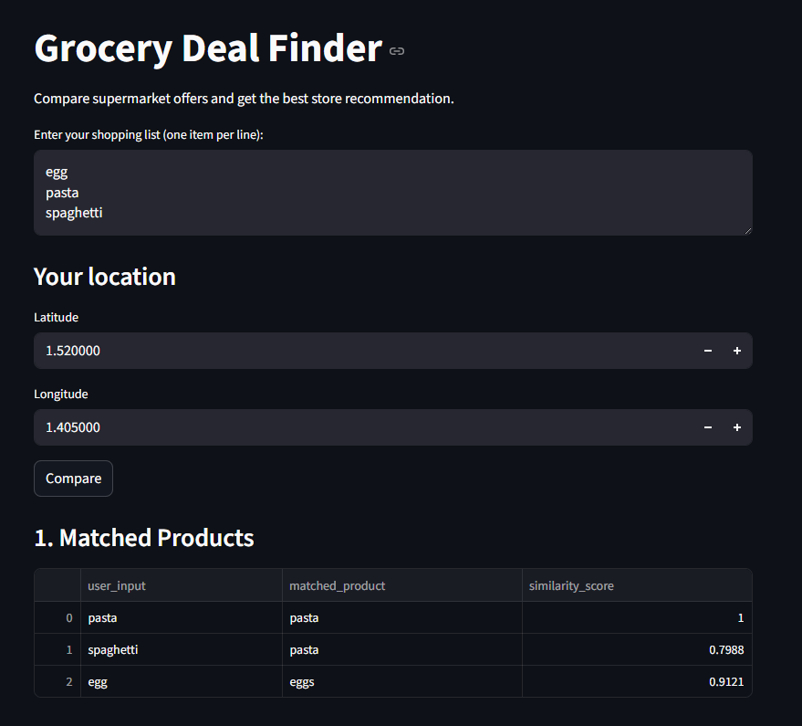
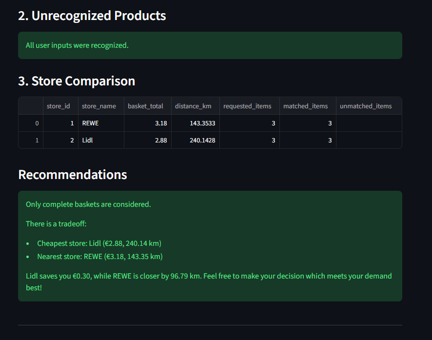
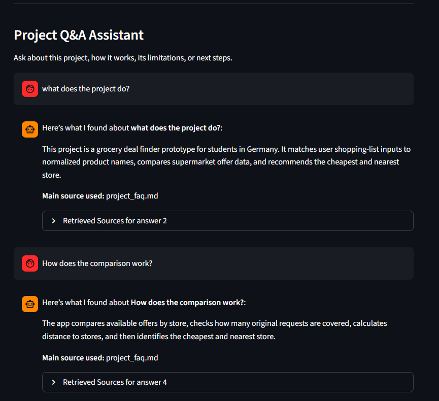

# Grocery Deal Finder

An AI-assisted prototype that helps students or budget-conscious consumers in Germany compare supermarket offers and find the best nearby store based on price and distance.

## Problem
Buyers often need to check multiple supermarket flyers and apps to find the best discounts. This takes time and makes it harder to save money.

---

## Project Goal
Build a simple app that:
- compares grocery offers across supermarkets
- ranks stores by basket price
- considers distance to stores
- recommends the best shopping option

---

## MVP Scope
The MVP focuses on a small but complete grocery comparison workflow:
* One city in Germany: Rosenheim
* A small set of supermarkets
* A limited product catalog of common grocery items
* Simple shopping-list input
* Product matching for different user wordings, such as “spaghetti” and “pasta”
* Store comparison based on available offers
* Basket coverage check to show which items each store can provide
* Distance-based comparison using the user’s location
* Separate results for the cheapest store and the nearest store
* Clear display of missing items, basket price, and distance

---

## Tech Stack
- Python
- FastAPI
- pandas
- numpy
- pytorch/tensorflow
- Streamlit
- sentence-transformer / NLP
- geopy
- Requests
- pytest
- scikit-learn
- OCR with Tesseract / pytesseract
- Ollama for local LLM cleanup
- REST API

---

## FastAPI Backend

The project now includes a FastAPI backend to separate the frontend UI from the core grocery recommendation logic.

The Streamlit app acts as the frontend, while FastAPI exposes backend endpoints for:

- retrieving available stores
- calculating nearby stores based on user location
- running the full grocery comparison pipeline
- returning matched products, store comparison, and recommendations as JSON

Main API endpoints:

```text
GET  /
GET  /stores
POST /stores/nearby
POST /stores/nearest
POST /compare
POST /ocr/shopping-list
```

---


## OCR and LLM Shopping-List Scanner

The project now includes an AI-powered shopping-list scanner.

Users can upload an image of a shopping list. The backend then:

1. receives the image through a FastAPI file-upload endpoint
2. extracts text from the image using OCR
3. cleans noisy OCR output using a local LLM through Ollama
4. sends the cleaned shopping list into the existing product-matching pipeline
5. compares stores by basket price and distance

This feature demonstrates how computer vision, LLMs, API development, and recommendation logic can work together in one practical application.

Main OCR endpoint:

```text
POST /ocr/shopping-list
```


---

## Current Project structure
```text
Grocery-deal-finder/
│
├── api/
│   └── main.py                  # FastAPI backend endpoints
│
├── app/
│   └── streamlit_app.py          # Streamlit frontend
│
├── data/
│   ├── products.csv              # Normalized product catalog
│   ├── product_aliases.csv       # Product aliases and synonym rules
│   ├── stores.csv                # Store information and coordinates
│   ├── offers.csv                # Sample supermarket offers
│   └── matcher_eval.csv          # Evaluation data for product matching
│
├── src/
│   ├── pipeline.py               # Main grocery comparison pipeline
│   ├── matcher.py                # Hybrid NLP product matcher
│   ├── matching_rules.py         # Alias and matching-rule loader
│   ├── compare.py                # Basket comparison logic
│   ├── recommend.py              # Cheapest / nearest recommendation logic
│   ├── distance.py               # Distance calculation logic
│   ├── ocr_reader.py             # OCR text extraction from shopping-list images
│   ├── llm_cleaner.py            # Local LLM cleaner for noisy OCR text
│   ├── load_data.py              # CSV data loading helpers
│   ├── evaluate_matcher.py       # Matcher evaluation script
│   └── project_rag.py            # Project Q&A retrieval assistant
│
│
├── tests/
│   ├── test_api.py               # test for general API endpoints
│   ├── test_ocr_reader.py        # test for OCR text parser / unit test
│   ├── test_ocr_image.py         # real image -> OCR test
│   ├── test_llm_cleaner.py       # test for LLM cleaning logic
│   ├── test_api_ocr.py           # OCR upload endpoint only
│   ├── test_compare.py           # Tests for comparison logic
│   ├── test_matcher.py           # Tests for product matcher
│   └── test_pipeline.py          # Tests for main pipeline
│
├── README.md                     # Project documentation
├── roadmap.md                    # Development roadmap
├── weekly_checklist.md           # Development checklist
├── project_faq.md                # Source file for Project Q&A Assistant
├── requirements.txt              # Python dependencies
└── pytest.ini                    # Pytest configuration
```

---

## How to Run

### 1. Clone the repository

```bash
git clone https://github.com/CorbyVo/Grocery-deal-finder.git
cd Grocery-deal-finder
```

### 2. Create and activate a virtual environment

```bash
python -m venv .venv
```

On Windows:

```bash
.venv\Scripts\activate
```

On macOS / Linux:

```bash
source .venv/bin/activate
```

### 3. Install dependencies

```bash
pip install -r requirements.txt
```

### 4. Start Ollama for LLM cleaning

The LLM cleaner uses a local Ollama model.

Install and run the model:

```bash
ollama pull llama3.2
ollama run llama3.2
```


### 5. Start the FastAPI backend

```bash
uvicorn api.main:app --reload
```

After starting the backend, open the FastAPI documentation:

```text
http://127.0.0.1:8000/docs
```

### 6. Start the Streamlit frontend

Open a second terminal and run:

```bash
streamlit run app/streamlit_app.py
```

---

## Project Status
This project is currently a working prototype. Current features:
- shopping-list input through Streamlit
- hybrid NLP product matching using semantic similarity and alias rules
- product alias data stored separately in CSV
- store comparison based on basket price and distance
- separate cheapest-store and nearest-store recommendations
- FastAPI backend for API-based comparison
- Streamlit frontend connected to the FastAPI backend
- Project Q&A Assistant using retrieval over project documents
- matcher evaluation script with a custom evaluation dataset
- OCR-based shopping-list image upload
- LLM-based cleanup for noisy OCR output using Ollama
- pytest suite currently passes: 13 tests passed

---

## Example Workflow
1. The user enters a shopping list in the Streamlit frontend.
2. The frontend sends the shopping list and user location to the FastAPI backend.
3. The FastAPI backend runs the grocery comparison pipeline.
4. The NLP matcher maps each raw user input to a normalized product name.
5. The app compares available offers across stores.
6. The app checks whether each store can cover the requested basket.
7. The app calculates the distance between the user and each store.
8. The app returns the cheapest store, nearest store, basket price, distance, and missing-item information.
9. The Streamlit frontend displays the matched products, store comparison, and final recommendation.

---

## Known Limitations
- Store and offer data is currently sample/manual data, not live supermarket data.
- The app currently focuses on a limited set of stores and grocery products.
- Quantity-aware basket comparison is not fully implemented yet.
- Matcher evaluation is based on a custom test set and should be expanded.
- The Project Q&A Assistant is retrieval-based and does not yet generate full LLM answers.
- Live supermarket API or flyer scraping is not implemented yet.
- OCR-based shopping-list input is implemented as a prototype and works best with clear printed shopping lists.
- Handwritten shopping lists may produce OCR errors.
- The LLM cleaner improves noisy OCR output but should still be validated by the user.
- Ollama must be running locally for the LLM cleaning feature.

---

## Next Steps

Planned improvements include:

- Improve OCR preprocessing for better image quality
- Add better support for handwritten shopping lists
- Add browser-based user location input
- Expand real store and offer data for Rosenheim
- Improve quantity-aware basket comparison
- Expand API tests for OCR upload and full end-to-end workflows
- Improve error handling when OCR or Ollama is unavailable

For a more detailed development plan, see `roadmap.md`.

---

## Roadmap
See `roadmap.md`

---

## Weekly Progress
See `weekly_checklist.md`

---

## Screenshots
### Homepage
  

### Grocery Comparison
 

### Project Q&A Assistant

